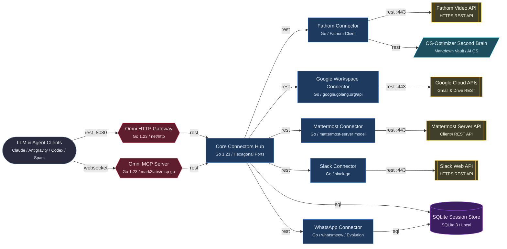
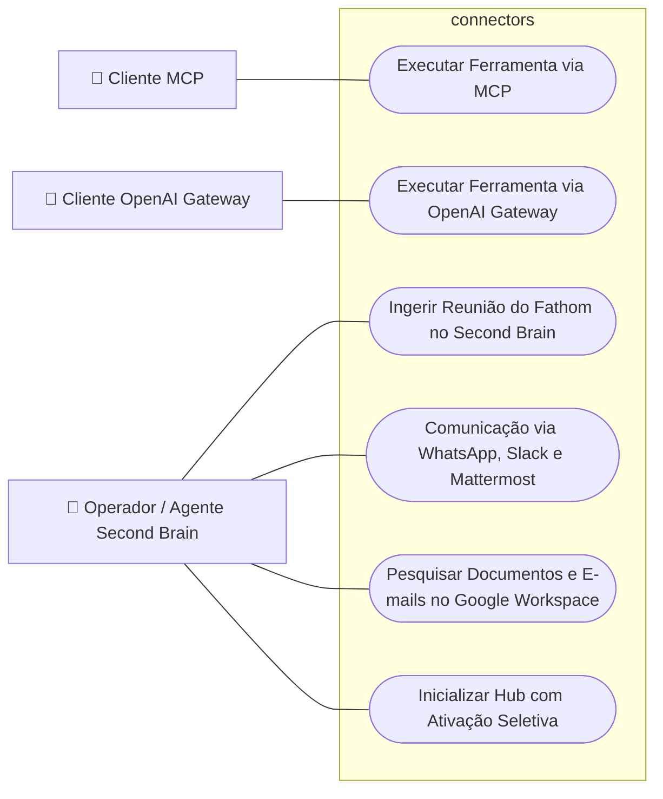
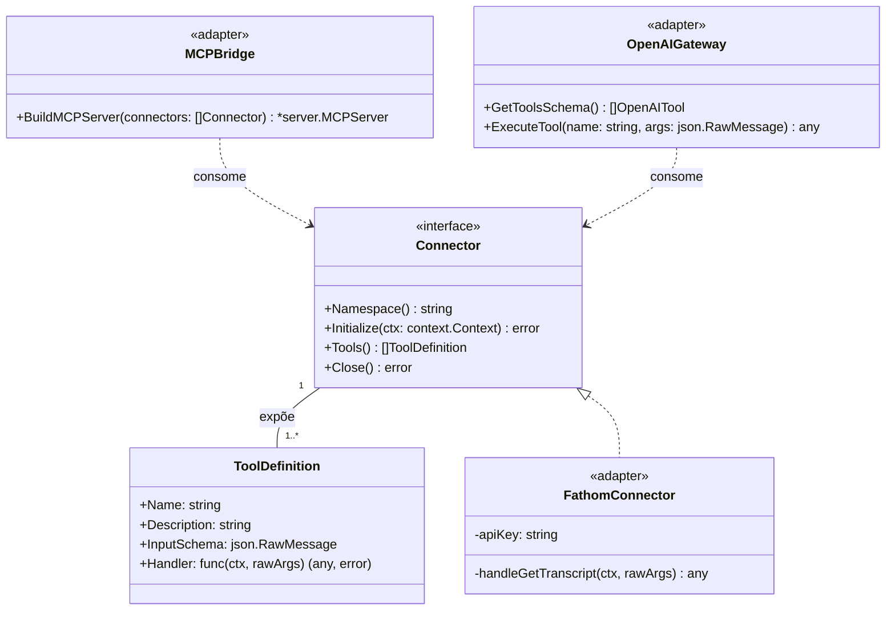
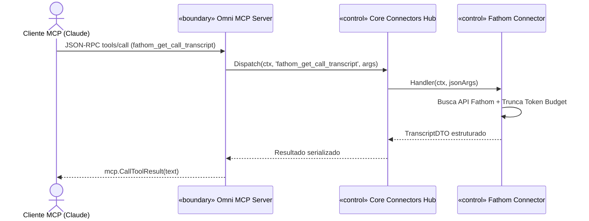
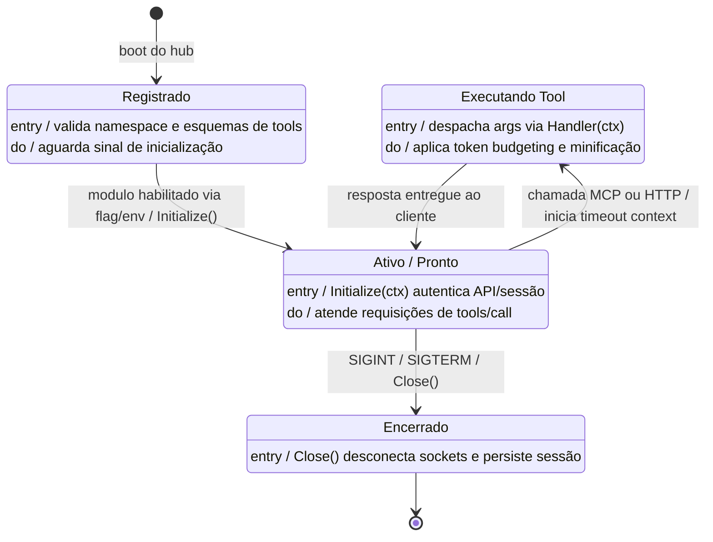

# AI MASTER IMPLEMENTATION SPECIFICATION — connectors

> Auto-gerado pelo ArchCode Studio | Hash de Integridade: `7fbb8e2` | Total Tasks: 16 | Gerado em: 2026-10-18 22:40
>
> **Este documento é o blueprint mestre de codificação.** Não reinterprete a arquitetura:
> implemente exatamente o que está aqui, na ordem indicada, e marque cada tarefa concluída
> com a ferramenta MCP `mark_task_status`. Se algo estiver ambíguo, use `get_system_context`
> antes de assumir qualquer coisa.

Hub Universal de Conectores em Go com Arquitetura Hexagonal, Servidor MCP e Gateway OpenAI Function Calling para LLMs e Second Brain

## 1. TECH STACK & SYSTEM INVARIANTS

- **Stack alvo:** Go 1.23 / mark3labs/mcp-go / net/http / SQLite
- **Componentes:** 15 | **Integrações:** 16 | **Casos de uso:** 6 | **Endpoints:** 3

- **Invariant 1:** A camada de domínio NUNCA importa pacotes de infraestrutura, banco de dados ou transporte HTTP.
- **Invariant 2:** Nenhum segredo, token ou credencial é versionado: toda configuração sensível vem de variáveis de ambiente.
- **Invariant 3:** Toda alteração de contrato de API exige atualização correspondente em `api/endpoints.yaml` no mesmo commit.
- **Invariant 4:** Acesso a `SQLite Session Store` acontece exclusivamente através da camada de repositório — nenhum SQL em handlers.
- **Invariant 5:** Chamadas a `Fathom Video API` são encapsuladas atrás de uma interface própria, com timeout e retry — nunca chamadas diretas espalhadas pelo código.
- **Invariant 6:** Chamadas a `Slack Web API` são encapsuladas atrás de uma interface própria, com timeout e retry — nunca chamadas diretas espalhadas pelo código.
- **Invariant 7:** Chamadas a `Mattermost Server API` são encapsuladas atrás de uma interface própria, com timeout e retry — nunca chamadas diretas espalhadas pelo código.
- **Invariant 8:** Chamadas a `Google Cloud APIs` são encapsuladas atrás de uma interface própria, com timeout e retry — nunca chamadas diretas espalhadas pelo código.
- **Invariant 9:** [RNF001] Proteção Estrita do Canal stdio (Logs em os.Stderr)
- **Invariant 10:** [RNF002] Token Budgeting e Minificação de DTOs
- **Invariant 11:** [RNF003] Arquitetura Hexagonal e Desacoplamento Monorepo
- **Invariant 12:** [RNF004] Gestão Segura de Credenciais e Tokens Locais
- **Invariant 13:** [RNF005] Baixa Latência e Cancelamento via Context

## 2. ARCHITECTURE TOPOLOGY

| Componente | Tipo | Tier | Tecnologia | Responsabilidade |
| :--- | :--- | :--- | :--- | :--- |
| `OS-Optimizer Second Brain` | storage | data | Markdown Vault / AI OS | Base de conhecimento local (Context, Memory em Meetings/ e Projects, Action skills). |
| `SQLite Session Store` | database | data | SQLite 3 / Local | Persistência local de credenciais e chaves criptográficas do whatsmeow em ~/.config/omni-connectors/. |
| `Core Connectors Hub` | compute | backend | Go 1.23 / Hexagonal Ports | Contrato agnóstico core.Connector, registro centralizado, token budgeting e poda de payloads. |
| `Fathom Connector` | compute | integration | Go / Fathom Client | Adapter para transcrições e resumos de gravações de reuniões do Fathom Video. |
| `Fathom Video API` | external_service | integration | HTTPS REST API | API externa de gravações e transcrições do Fathom Video. |
| `Google Cloud APIs` | external_service | integration | Gmail & Drive REST | APIs externas do Google Workspace (Gmail v1 e Drive v3). |
| `Google Workspace Connector` | compute | integration | Go / google.golang.org/api | Adapter para Gmail v1 e Google Drive v3 com OAuth2 local e refresh de token. |
| `Mattermost Connector` | compute | integration | Go / mattermost-server model | Adapter para postagens e canais no Mattermost via Personal Access Token. |
| `Mattermost Server API` | external_service | integration | Client4 REST API | Instância remota da API do Mattermost. |
| `Omni HTTP Gateway` | gateway | integration | Go 1.23 / net/http | Bridge primária REST para OpenAI Function Calling (/v1/tools e /v1/tools/execute). |
| `Omni MCP Server` | gateway | integration | Go 1.23 / mark3labs/mcp-go | Bridge primária de entrada para protocolo MCP (stdio e SSE) com isolamento de stdout. |
| `Slack Connector` | compute | integration | Go / slack-go | Adapter para canais, postagem e buscas no Slack via User Tokens ou Bot Tokens. |
| `Slack Web API` | external_service | integration | HTTPS REST API | API externa do Slack para mensagens e canais. |
| `WhatsApp Connector` | compute | integration | Go / whatsmeow / Evolution | Adapter para mensagens WhatsApp com persistência SQLite de sessão multidevice. |
| `LLM & Agent Clients` | client | frontend | Claude / Antigravity / Codex / Spark | Clientes e agentes de IA que invocam ferramentas via MCP ou OpenAI Function Calling. |

### 2.1 Fluxos de Comunicação

| Origem | Destino | Protocolo | Porta | Segurança | Descrição |
| :--- | :--- | :--- | :--- | :--- | :--- |
| LLM & Agent Clients | Omni HTTP Gateway | rest | 8080 | - | Endpoints HTTP REST para OpenAI Function Calling |
| LLM & Agent Clients | Omni MCP Server | websocket | - | - | Comunicação JSON-RPC 2.0 via stdio ou SSE |
| Core Connectors Hub | Fathom Connector | rest | - | - | Invocação interna do conector Fathom |
| Core Connectors Hub | Google Workspace Connector | rest | - | - | Invocação interna do conector Google |
| Core Connectors Hub | Mattermost Connector | rest | - | - | Invocação interna do conector Mattermost |
| Core Connectors Hub | Slack Connector | rest | - | - | Invocação interna do conector Slack |
| Core Connectors Hub | SQLite Session Store | sql | - | - | Configurações e sessões locais |
| Core Connectors Hub | WhatsApp Connector | rest | - | - | Invocação interna do conector WhatsApp |
| Fathom Connector | Fathom Video API | rest | 443 | - | Chamada HTTP à API externa do Fathom |
| Fathom Connector | OS-Optimizer Second Brain | rest | - | - | Alimentação direta de transcrições e atas em Meetings/ e Projects/ |
| Google Workspace Connector | Google Cloud APIs | rest | 443 | - | Chamadas REST às APIs Gmail e Drive |
| Omni HTTP Gateway | Core Connectors Hub | rest | - | - | Despacho in-process de Function Calling para core.ToolDefinition |
| Mattermost Connector | Mattermost Server API | rest | 443 | - | Chamadas Client4 REST ao Mattermost |
| Omni MCP Server | Core Connectors Hub | rest | - | - | Despacho in-process de chamadas MCP para core.ToolDefinition |
| Slack Connector | Slack Web API | rest | 443 | - | Chamadas REST à API do Slack |
| WhatsApp Connector | SQLite Session Store | sql | - | - | Persistência de sessão SQLite multidevice |

## 3. API CONTRACTS

Base URL: `/v1`

| Método | Rota | Auth | Origem → Destino | Resumo |
| :--- | :--- | :--- | :--- | :--- |
| `GET` | `/v1/tools` | none | LLM & Agent Clients → Omni HTTP Gateway | Lista ferramentas disponíveis no formato OpenAI Function Calling |
| `POST` | `/v1/tools/execute` | none | LLM & Agent Clients → Omni HTTP Gateway | Executa dinamicamente uma ferramenta por nome e argumentos JSON |
| `GET` | `/v1/health` | none | LLM & Agent Clients → Omni HTTP Gateway | Retorna a integridade do hub e lista os conectores ativos |

#### `GET /v1/tools`

- **Response:** `{"tools": [{"type": "function", "function": {"name": string, "description": string, "parameters": object}}]}`
- **Status:** `200`, `500`

#### `POST /v1/tools/execute`

- **Request:** `{"name": string, "arguments": object}`
- **Response:** `{"result": any, "error": string}`
- **Status:** `200`, `400`, `404`, `500`

#### `GET /v1/health`

- **Response:** `{"status": "ok", "enabled_connectors": string[], "version": string}`
- **Status:** `200`

## 4. TOPOLOGICAL IMPLEMENTATION SEQUENCE

Implemente estritamente nesta ordem. Uma tarefa só pode começar quando todas as suas dependências estiverem `completed`.

- [x] **TASK-OS-01 (Data Tier):** Implementar OS-Optimizer Second Brain (Markdown Vault / AI OS)
  - *Dependências:* Nenhuma
  - *Requisitos:* RF010
  - *Casos de uso:* CDU003
  - *Critério de Aceite:* Upload e download assinados funcionam e objetos privados não são acessíveis sem assinatura.
- [x] **TASK-SQLITE-01 (Data Tier):** Implementar SQLite Session Store (SQLite 3 / Local)
  - *Dependências:* Nenhuma
  - *Requisitos:* RF005, RNF004
  - *Casos de uso:* CDU004
  - *Critério de Aceite:* Migrações idempotentes criam o schema de `SQLite Session Store` e podem ser aplicadas duas vezes sem erro.
  - *Critério de Aceite:* Rollback da última migração restaura o schema anterior sem perda de dados de teste.
- [x] **TASK-FATHOM-01 (Integration Tier):** Implementar Fathom Video API (HTTPS REST API)
  - *Dependências:* Nenhuma
  - *Requisitos:* RF004
  - *Casos de uso:* CDU003
  - *Critério de Aceite:* Integração com `Fathom Video API` possui timeout, retry com backoff e client fake para testes.
  - *Critério de Aceite:* Credenciais vêm de variáveis de ambiente — nunca versionadas no repositório.
- [x] **TASK-FATHOM-02 (Integration Tier):** Implementar Fathom Connector (Go / Fathom Client)
  - *Dependências:* TASK-FATHOM-01, TASK-OS-01
  - *Requisitos:* RF004, RF010, RNF002
  - *Casos de uso:* CDU003
  - *Critério de Aceite:* Testes unitários da lógica de `Fathom Connector` cobrem cenários de sucesso e de falha.
- [x] **TASK-GOOGLE-01 (Integration Tier):** Implementar Google Cloud APIs (Gmail & Drive REST)
  - *Dependências:* Nenhuma
  - *Requisitos:* RF008
  - *Casos de uso:* CDU005
  - *Critério de Aceite:* Integração com `Google Cloud APIs` possui timeout, retry com backoff e client fake para testes.
  - *Critério de Aceite:* Credenciais vêm de variáveis de ambiente — nunca versionadas no repositório.
- [x] **TASK-GOOGLE-02 (Integration Tier):** Implementar Google Workspace Connector (Go / google.golang.org/api)
  - *Dependências:* TASK-GOOGLE-01
  - *Requisitos:* RF008, RNF002, RNF004
  - *Casos de uso:* CDU005
  - *Critério de Aceite:* Testes unitários da lógica de `Google Workspace Connector` cobrem cenários de sucesso e de falha.
- [x] **TASK-MATTERMO-01 (Integration Tier):** Implementar Mattermost Server API (Client4 REST API)
  - *Dependências:* Nenhuma
  - *Requisitos:* RF007
  - *Casos de uso:* CDU004
  - *Critério de Aceite:* Integração com `Mattermost Server API` possui timeout, retry com backoff e client fake para testes.
  - *Critério de Aceite:* Credenciais vêm de variáveis de ambiente — nunca versionadas no repositório.
- [x] **TASK-MATTERMO-02 (Integration Tier):** Implementar Mattermost Connector (Go / mattermost-server model)
  - *Dependências:* TASK-MATTERMO-01
  - *Requisitos:* RF007
  - *Casos de uso:* CDU004
  - *Critério de Aceite:* Testes unitários da lógica de `Mattermost Connector` cobrem cenários de sucesso e de falha.
- [x] **TASK-SLACK-01 (Integration Tier):** Implementar Slack Web API (HTTPS REST API)
  - *Dependências:* Nenhuma
  - *Requisitos:* RF006
  - *Casos de uso:* CDU004
  - *Critério de Aceite:* Integração com `Slack Web API` possui timeout, retry com backoff e client fake para testes.
  - *Critério de Aceite:* Credenciais vêm de variáveis de ambiente — nunca versionadas no repositório.
- [x] **TASK-SLACK-02 (Integration Tier):** Implementar Slack Connector (Go / slack-go)
  - *Dependências:* TASK-SLACK-01
  - *Requisitos:* RF006, RNF002
  - *Casos de uso:* CDU004
  - *Critério de Aceite:* Testes unitários da lógica de `Slack Connector` cobrem cenários de sucesso e de falha.
- [x] **TASK-WHATSAPP-01 (Integration Tier):** Implementar WhatsApp Connector (Go / whatsmeow / Evolution)
  - *Dependências:* TASK-SQLITE-01
  - *Requisitos:* RF005, RNF004
  - *Casos de uso:* CDU004
  - *Critério de Aceite:* Testes unitários da lógica de `WhatsApp Connector` cobrem cenários de sucesso e de falha.
- [x] **TASK-CORE-01 (Service Tier):** Implementar Core Connectors Hub (Go 1.23 / Hexagonal Ports)
  - *Dependências:* TASK-FATHOM-02, TASK-GOOGLE-02, TASK-MATTERMO-02, TASK-SLACK-02, TASK-SQLITE-01, TASK-WHATSAPP-01
  - *Requisitos:* RF001, RF002, RF003, RF004, RF005, RF006, RF007, RF008, RF009, RF010, RNF001, RNF002, RNF003, RNF004, RNF005
  - *Casos de uso:* CDU001, CDU002, CDU003, CDU004, CDU005, CDU006
  - *Critério de Aceite:* Testes unitários da lógica de `Core Connectors Hub` cobrem cenários de sucesso e de falha.
- [x] **TASK-OMNI-01 (Integration Tier):** Implementar Omni HTTP Gateway (Go 1.23 / net/http)
  - *Dependências:* TASK-CORE-01
  - *Requisitos:* RF003, RF009, RNF003, RNF005
  - *Casos de uso:* CDU002, CDU006
  - *Contratos:* `GET /v1/health`, `GET /v1/tools`, `POST /v1/tools/execute`
  - *Critério de Aceite:* Rotas desconhecidas retornam 404 e erros upstream retornam 502 com corpo padronizado.
  - *Critério de Aceite:* Rate limiting e CORS configurados e cobertos por teste de integração.
  - *Critério de Aceite:* Contrato `GET /v1/health` implementado e validado contra `api/endpoints.yaml`.
  - *Critério de Aceite:* Contrato `GET /v1/tools` implementado e validado contra `api/endpoints.yaml`.
  - *Critério de Aceite:* Contrato `POST /v1/tools/execute` implementado e validado contra `api/endpoints.yaml`.
- [x] **TASK-OMNI-02 (Integration Tier):** Implementar Omni MCP Server (Go 1.23 / mark3labs/mcp-go)
  - *Dependências:* TASK-CORE-01
  - *Requisitos:* RF002, RF009, RNF001, RNF003, RNF005
  - *Casos de uso:* CDU001, CDU006
  - *Critério de Aceite:* Rotas desconhecidas retornam 404 e erros upstream retornam 502 com corpo padronizado.
  - *Critério de Aceite:* Rate limiting e CORS configurados e cobertos por teste de integração.
- [x] **TASK-LLM-01 (Presentation Tier):** Implementar LLM & Agent Clients (Claude / Antigravity / Codex / Spark)
  - *Dependências:* TASK-OMNI-01, TASK-OMNI-02
  - *Casos de uso:* CDU001, CDU002
  - *Contratos:* `GET /v1/health`, `GET /v1/tools`, `POST /v1/tools/execute`
  - *Critério de Aceite:* A interface consome exclusivamente os contratos declarados em `api/endpoints.yaml`.
  - *Critério de Aceite:* Estados de carregamento, vazio e erro estão implementados em todas as telas do fluxo.
  - *Critério de Aceite:* Contrato `GET /v1/health` implementado e validado contra `api/endpoints.yaml`.
  - *Critério de Aceite:* Contrato `GET /v1/tools` implementado e validado contra `api/endpoints.yaml`.
  - *Critério de Aceite:* Contrato `POST /v1/tools/execute` implementado e validado contra `api/endpoints.yaml`.
- [x] **TASK-E2E-01 (DevOps Tier):** Testes ponta a ponta dos casos de uso
  - *Dependências:* TASK-OS-01, TASK-SQLITE-01, TASK-FATHOM-01, TASK-FATHOM-02, TASK-GOOGLE-01, TASK-GOOGLE-02, TASK-MATTERMO-01, TASK-MATTERMO-02, TASK-SLACK-01, TASK-SLACK-02, TASK-WHATSAPP-01, TASK-CORE-01, TASK-OMNI-01, TASK-OMNI-02, TASK-LLM-01
  - *Critério de Aceite:* [CDU001] **Given** um cliente MCP conectado via stdio **When** envia `tools/call` com `{name: "fathom_get_call_transcript", arguments: {"recording_id": "rec_123"}}` **Then** recebe `mcp.CallToolResult` contendo o resumo e transcrição no formato textual.
  - *Critério de Aceite:* [CDU001] **Given** uma biblioteca externa gerando logs durante a execução **When** emite texto de debug **Then** todo o conteúdo é direcionado para `os.Stderr` e o cliente MCP não desconecta.
  - *Critério de Aceite:* [CDU002] **Given** o servidor HTTP em execução **When** recebe `GET /v1/tools` **Then** retorna status 200 com array `tools` onde cada item possui `type: "function"` e o esquema dos parâmetros.
  - *Critério de Aceite:* [CDU002] **Given** uma requisição `POST /v1/tools/execute` com argumentos válidos **When** processada pelo gateway **Then** retorna HTTP 200 e o payload JSON produzido pelo conector.
  - *Critério de Aceite:* [CDU003] **Given** uma gravação concluída no Fathom **When** o conector executa `fathom_get_call_transcript` **Then** retorna DTO contendo resumo e transcrição limpa sem HTML redundante.
  - *Critério de Aceite:* [CDU003] **Given** o retorno da ferramenta **When** o operador processa com `meeting-intelligence` **Then** um novo arquivo Markdown é criado em `OS-Optimizer-Playbook/Meetings/` e tarefas são cadastradas em `Projects/active-projects.md`.
  - *Critério de Aceite:* [CDU004] **Given** credenciais válidas do Slack **When** invocada `slack_send_message` com canal e texto **Then** a mensagem é postada no Slack e a tool devolve `{"status": "delivered", "message_id": "<id>"}`.
  - *Critério de Aceite:* [CDU004] **Given** busca em mensagens do Mattermost **When** invocada `mattermost_search_posts` **Then** retorna lista filtrada contendo no máximo 10 snippets compactos.
  - *Critério de Aceite:* [CDU005] **Given** token de autenticação Google válido **When** invocada `gmail_search_messages` com uma consulta **Then** retorna lista de e-mails em texto puro sem tags HTML.
  - *Critério de Aceite:* [CDU005] **Given** uma requisição de busca no Drive **When** executada com sucesso **Then** retorna IDs e títulos dos arquivos encontrados em formato JSON conciso.
  - *Critério de Aceite:* [CDU006] **Given** o comando `omni-mcp --enable=fathom` **When** o cliente executa `tools/list` **Then** apenas ferramentas com prefixo `fathom_` são listadas.
  - *Critério de Aceite:* [CDU006] **Given** uma chamada a `GET /v1/health` **When** o gateway foi iniciado com `--enable=slack,mattermost` **Then** o JSON de resposta exibe `enabled_connectors: ["slack", "mattermost"]`.

## 5. USE CASE ACCEPTANCE CRITERIA

### CDU001 — Executar Ferramenta via MCP

- **Atores:** Cliente MCP (Claude Desktop, Claude Code, Antigravity CLI)
- **Componentes:** node-llm-clients, node-omni-mcp, node-core-hub

**Fluxo Principal:**

1. O cliente MCP envia a mensagem JSON-RPC `tools/list` pelo canal `stdio` ou conexão SSE.
2. O servidor `omni-mcp` itera pelos conectores habilitados e responde com o catálogo de ferramentas e seus esquemas de entrada.
3. O LLM decide chamar uma ferramenta (ex: `fathom_get_call_transcript`) e envia `tools/call` com os argumentos JSON correspondentes.
4. O bridge `internal/bridge/mcp` intercepta a chamada, valida os parâmetros e delega para o `Handler` agnóstico em `core.ToolDefinition`.
5. O conector executa a operação e retorna o resultado estruturado.
6. O bridge serializa o resultado em JSON indentado e devolve um `mcp.CallToolResult` para o cliente.

- **Given** um cliente MCP conectado via stdio **When** envia `tools/call` com `{name: "fathom_get_call_transcript", arguments: {"recording_id": "rec_123"}}` **Then** recebe `mcp.CallToolResult` contendo o resumo e transcrição no formato textual.
- **Given** uma biblioteca externa gerando logs durante a execução **When** emite texto de debug **Then** todo o conteúdo é direcionado para `os.Stderr` e o cliente MCP não desconecta.

**Regras de Negócio:**

- A saída padrão `os.Stdout` nunca deve receber bytes fora da especificação JSON-RPC.
- Todas as mensagens de erro retornadas para o LLM devem ser amigáveis e concisas.

### CDU002 — Executar Ferramenta via OpenAI Gateway

- **Atores:** Cliente Function Calling (OpenAI Codex, Spark, LiteLLM, SDKs)
- **Componentes:** node-llm-clients, node-omni-http, node-core-hub

**Fluxo Principal:**

1. O cliente HTTP envia `GET /v1/tools`.
2. O gateway `omni-http` lê os `core.ToolDefinition` de todos os conectores ativos e monta a lista `tools: [{"type": "function", "function": {"name": t.Name, "description": t.Description, "parameters": t.InputSchema}}]`.
3. O modelo de linguagem gera uma chamada de função correspondente.
4. O cliente envia `POST /v1/tools/execute` com o payload JSON `{ "name": "slack_send_message", "arguments": { "channel": "#general", "message": "Deploy concluído" } }`.
5. O gateway localiza o handler no mapa em memória e despacha a execução.
6. O resultado retornado pelo conector é empacotado em `{ "result": <payload>, "error": null }` com status HTTP 200.

- **Given** o servidor HTTP em execução **When** recebe `GET /v1/tools` **Then** retorna status 200 com array `tools` onde cada item possui `type: "function"` e o esquema dos parâmetros.
- **Given** uma requisição `POST /v1/tools/execute` com argumentos válidos **When** processada pelo gateway **Then** retorna HTTP 200 e o payload JSON produzido pelo conector.

**Regras de Negócio:**

- O gateway deve suportar CORS se configurado para permitir acesso via browser ou ferramentas web.
- O formato de parâmetros em `parameters` deve ser estritamente compatível com JSON Schema Draft 7.

### CDU003 — Ingerir Reunião do Fathom no Second Brain

- **Atores:** Agente Second Brain / Operador
- **Componentes:** node-conn-fathom, node-ext-fathom, node-second-brain, node-core-hub

**Fluxo Principal:**

1. O agente de IA executa a ferramenta `fathom_list_recordings` para identificar novas chamadas ou recebe o `recording_id` como parâmetro.
2. O conector Fathom faz a requisição autenticada à API externa do Fathom Video.
3. O conector processa a transcrição bruta, limpando metadados desnecessários e aplicando truncamento inteligente conforme o token budget (RNF002).
4. O conector retorna um DTO estruturado contendo: título, data, participantes, resumo executivo e segmentos de fala.
5. O agente aciona a skill `meeting-intelligence` do `OS-Optimizer-Playbook`.
6. A skill formata o documento da reunião em `Meetings/YYYY-MM-DD-titulo-da-reuniao.md`.
7. As tarefas levantadas com responsáveis e prazos são adicionadas à tabela de projetos em `Projects/active-projects.md`.

- **Given** uma gravação concluída no Fathom **When** o conector executa `fathom_get_call_transcript` **Then** retorna DTO contendo resumo e transcrição limpa sem HTML redundante.
- **Given** o retorno da ferramenta **When** o operador processa com `meeting-intelligence` **Then** um novo arquivo Markdown é criado em `OS-Optimizer-Playbook/Meetings/` e tarefas são cadastradas em `Projects/active-projects.md`.

**Regras de Negócio:**

- Transcrições não devem sobrecarregar a janela de contexto; quando ultrapassarem 15.000 tokens, o conector deve priorizar o resumo estruturado e disponibilizar paginação ou busca por tópicos.
- Wikilinks do Second Brain (`[[active-projects]]`, `[[company]]`) devem ser preservados nas atas geradas.

### CDU004 — Comunicação via WhatsApp, Slack e Mattermost

- **Atores:** Agente de IA / Operador
- **Componentes:** node-conn-whatsapp, node-sqlite-session, node-conn-slack, node-ext-slack, node-conn-mattermost, node-ext-mattermost, node-core-hub

**Fluxo Principal:**

1. O agente recebe a instrução de notificar um canal ou buscar contexto recente.
2. O conector correspondente é acionado (ex: `slack_send_message` ou `whatsapp_send_message`).
3. O payload é validado contra o esquema da ferramenta.
4. O conector realiza a chamada de rede utilizando a biblioteca especializada em Go (`slack-go`, `whatsmeow` ou `mattermost-server/model`).
5. A resposta de confirmação com ID da mensagem e status é devolvida ao agente.

- **Given** credenciais válidas do Slack **When** invocada `slack_send_message` com canal e texto **Then** a mensagem é postada no Slack e a tool devolve `{"status": "delivered", "message_id": "<id>"}`.
- **Given** busca em mensagens do Mattermost **When** invocada `mattermost_search_posts` **Then** retorna lista filtrada contendo no máximo 10 snippets compactos.

**Regras de Negócio:**

- Em modo stdio, conexões persistentes (como o WebSocket do whatsmeow) devem ser tratadas de forma desacoplada ou rodar via daemon para não reconectar a cada invocation de tool.
- Credenciais e bancos de sessão SQLite devem ser salvos exclusivamente em `~/.config/omni-connectors/`.

### CDU005 — Pesquisar Documentos e E-mails no Google Workspace

- **Atores:** Agente de IA / Operador
- **Componentes:** node-conn-google, node-ext-google, node-core-hub

**Fluxo Principal:**

1. O agente invoca `gmail_search_messages` com query no padrão de busca do Gmail (ex: `from:cliente import:true newer_than:7d`).
2. O conector Google executa a busca via `google.golang.org/api/gmail/v1`.
3. O conector recupera as mensagens correspondentes e elimina código HTML, scripts, estilos CSS e headers desnecessários.
4. É retornado um DTO contendo apenas remetente, assunto, data e corpo em texto puro sumarizado.
5. Em consultas ao Google Drive (`drive_search_files`), o conector lista os arquivos com nome, ID, link e data de modificação.

- **Given** token de autenticação Google válido **When** invocada `gmail_search_messages` com uma consulta **Then** retorna lista de e-mails em texto puro sem tags HTML.
- **Given** uma requisição de busca no Drive **When** executada com sucesso **Then** retorna IDs e títulos dos arquivos encontrados em formato JSON conciso.

**Regras de Negócio:**

- O corpo de e-mails extensos deve ser truncado em no máximo 3.000 caracteres por mensagem, fornecendo aviso de truncamento se necessário.
- Nenhum token OAuth2 deve ser exposto nos logs ou respostas das ferramentas.

### CDU006 — Inicializar Hub com Ativação Seletiva

- **Atores:** Operador / Sistema CLI
- **Componentes:** node-core-hub, node-omni-mcp, node-omni-http

**Fluxo Principal:**

1. O operador ou cliente executa `omni-mcp --enable=fathom,slack`.
2. O sistema lê as flags e variáveis de ambiente.
3. O registro central filtra a lista de conectores disponíveis, instanciando e inicializando apenas os selecionados.
4. O servidor MCP ou HTTP publica unicamente as ferramentas desses módulos.
5. Em consultas de saúde (`GET /v1/health`), a lista de conectores ativos reflete exatamente os módulos em execução.

- **Given** o comando `omni-mcp --enable=fathom` **When** o cliente executa `tools/list` **Then** apenas ferramentas com prefixo `fathom_` são listadas.
- **Given** uma chamada a `GET /v1/health` **When** o gateway foi iniciado com `--enable=slack,mattermost` **Then** o JSON de resposta exibe `enabled_connectors: ["slack", "mattermost"]`.

**Regras de Negócio:**

- O tempo de inicialização do processo deve ser inferior a 1 segundo para não atrasar a inicialização do cliente MCP via stdio.

## 6. REQUIREMENTS TRACEABILITY

| ID | Tipo | Título | Prioridade | Componentes | Tarefas |
| :--- | :--- | :--- | :--- | :--- | :--- |
| `RF001` | RF | Contrato Universal e Registro Hexagonal de Conectores | Alta | node-core-hub | TASK-CORE-01 |
| `RF002` | RF | Exposição MCP Nativa via stdio e SSE | Alta | node-omni-mcp, node-core-hub | TASK-CORE-01, TASK-OMNI-02 |
| `RF003` | RF | Gateway REST de OpenAI Function Calling | Alta | node-omni-http, node-core-hub | TASK-CORE-01, TASK-OMNI-01 |
| `RF004` | RF | Conector Fathom Video para Transcrições e Resumos | Alta | node-conn-fathom, node-ext-fathom, node-core-hub | TASK-FATHOM-01, TASK-FATHOM-02, TASK-CORE-01 |
| `RF005` | RF | Conector WhatsApp | Média | node-conn-whatsapp, node-sqlite-session, node-core-hub | TASK-SQLITE-01, TASK-WHATSAPP-01, TASK-CORE-01 |
| `RF006` | RF | Conector Slack com Suporte a User e Bot Tokens | Média | node-conn-slack, node-ext-slack, node-core-hub | TASK-SLACK-01, TASK-SLACK-02, TASK-CORE-01 |
| `RF007` | RF | Conector Mattermost via Client4 | Baixa | node-conn-mattermost, node-ext-mattermost, node-core-hub | TASK-MATTERMO-01, TASK-MATTERMO-02, TASK-CORE-01 |
| `RF008` | RF | Conector Google Workspace (Gmail e Google Drive) | Média | node-conn-google, node-ext-google, node-core-hub | TASK-GOOGLE-01, TASK-GOOGLE-02, TASK-CORE-01 |
| `RF009` | RF | Ativação Seletiva e Modulação de Ferramentas | Alta | node-core-hub, node-omni-mcp, node-omni-http | TASK-CORE-01, TASK-OMNI-01, TASK-OMNI-02 |
| `RF010` | RF | Integração com o Second Brain (OS-Optimizer-Playbook) | Alta | node-second-brain, node-conn-fathom, node-core-hub | TASK-OS-01, TASK-FATHOM-02, TASK-CORE-01 |
| `RNF001` | RNF | Proteção Estrita do Canal stdio (Logs em os.Stderr) | Alta | node-omni-mcp, node-core-hub | TASK-CORE-01, TASK-OMNI-02 |
| `RNF002` | RNF | Token Budgeting e Minificação de DTOs | Alta | node-core-hub, node-conn-fathom, node-conn-google, node-conn-slack | TASK-FATHOM-02, TASK-GOOGLE-02, TASK-SLACK-02, TASK-CORE-01 |
| `RNF003` | RNF | Arquitetura Hexagonal e Desacoplamento Monorepo | Alta | node-core-hub, node-omni-mcp, node-omni-http | TASK-CORE-01, TASK-OMNI-01, TASK-OMNI-02 |
| `RNF004` | RNF | Gestão Segura de Credenciais e Tokens Locais | Alta | node-conn-google, node-conn-whatsapp, node-sqlite-session, node-core-hub | TASK-SQLITE-01, TASK-GOOGLE-02, TASK-WHATSAPP-01, TASK-CORE-01 |
| `RNF005` | RNF | Baixa Latência e Cancelamento via Context | Média | node-core-hub, node-omni-mcp, node-omni-http | TASK-CORE-01, TASK-OMNI-01, TASK-OMNI-02 |

## 7. UML MODELS

Modelos detalhados de comportamento e estrutura. Implemente classes, mensagens e transições exatamente como modelados; `component_id` aponta o componente do diagrama macro que os realiza.

### Casos de Uso — Universal LLM Connectors (usecase)

Gerado a partir das fichas em docs/casos-de-uso.

### Modelo de Domínio — Universal Connectors (class)

Contratos agnósticos da arquitetura hexagonal, bridges e conectores.

### CDU001 — Executar Ferramenta via MCP (sequence)

Fluxo de execução de ferramenta via Model Context Protocol (stdio/SSE).

### Ciclo de vida do conector (state)

Estados de ciclo de vida de um conector no Hub Hexagonal.

## 8. ARCHITECTURE DECISIONS (ADR)

- **ADR-001 — Arquitetura Hexagonal e Dupla Exposição de Protocolos (MCP e OpenAI Tools)** (Aceito): Adotamos a **Arquitetura Hexagonal (Ports & Adapters)** com um monorepo em Go: - **Port Primário (Contrato Universal):** No pacote `internal/core`, definimos a interface `core.Connector` e a struct `…
- **ADR-002 — Isolamento Estrito de I/O em Stdio e Token Budgeting para LLMs** (Aceito): 1.

## 9. AGENT EXECUTION PROTOCOL

1. Chame `get_implementation_tasks` com `status: "pending"` e pegue a primeira tarefa cujas dependências já estejam `completed`.
2. Chame `mark_task_status` com `in_progress` antes de escrever código.
3. Implemente somente o escopo daquela tarefa, respeitando todos os invariantes da seção 1.
4. Execute os testes que provam cada *Critério de Aceite* da tarefa.
5. Chame `mark_task_status` com `completed` e uma nota curta descrevendo a evidência (comando de teste e resultado).
6. Se a arquitetura precisar mudar, use `add_architecture_node` / `connect_nodes` / `upsert_requirement` e regenere este documento com `generate_ai_prd`. Nunca edite `.arch/diagrams/macro.json` à mão.

---

> Gerado pelo ArchCode Studio. Regenerar este arquivo preserva o status já registrado das tarefas.
