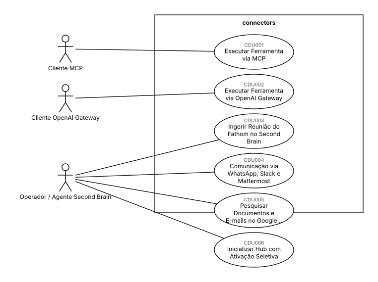
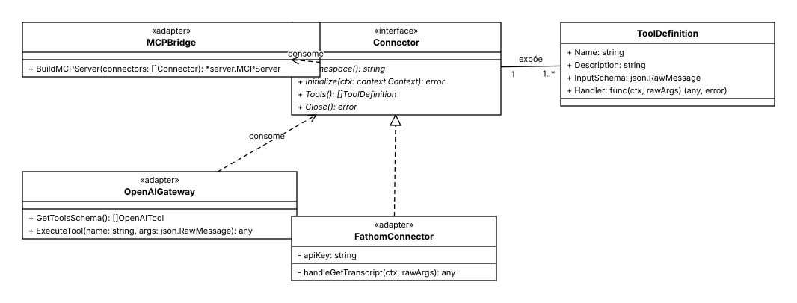
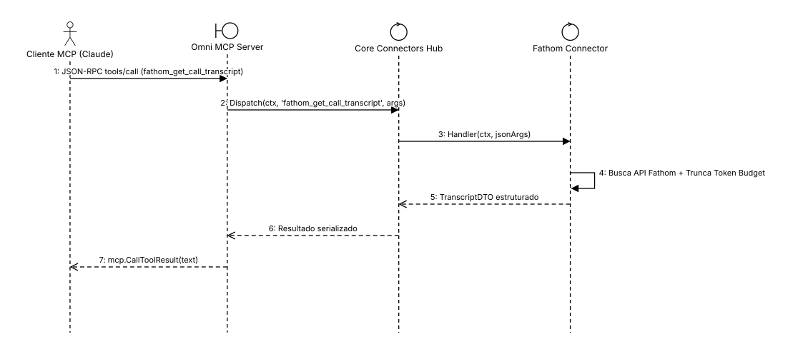
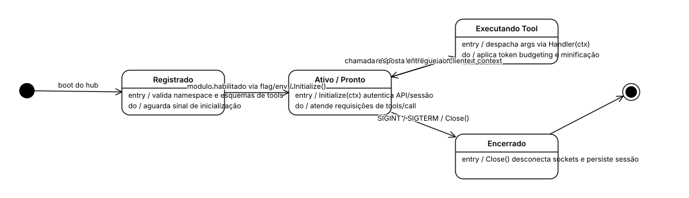
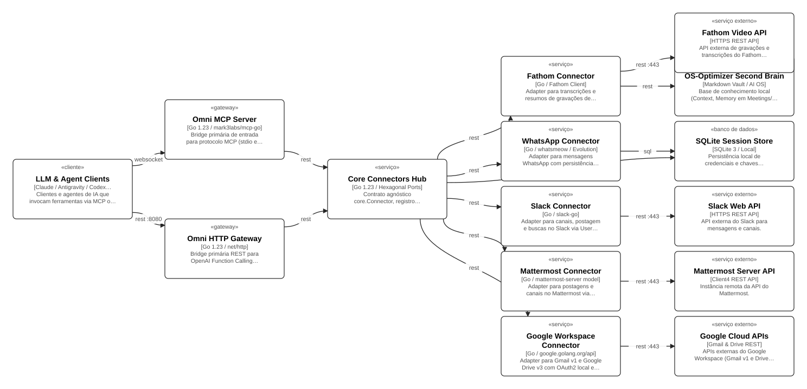

**Documento de Requisitos — Universal LLM Connectors Hub**

connectors

18/10/2026

Versão 1.0

Vitor Sergio

**Histórico de Alterações**

| Data | Versão | Descrição | Autor |
| ----- | ----- | ----- | ----- |
| 18/10/2026 | 1.0 | Especificação e planejamento arquitetural com ArchCode Studio e OS-Optimizer-Playbook. | Vitor Sergio |

**Sumário**

- **[1 Introdução](#introducao)**
  - [1.1 Visão geral do documento](#visao-geral-do-documento)
  - [1.2 Convenções, termos e abreviações](#convencoes-termos-e-abreviacoes)
    - [1.2.1 Identificação dos requisitos](#identificacao-dos-requisitos)
    - [1.2.2 Prioridades dos requisitos](#prioridades-dos-requisitos)
- **[2 Descrição geral do sistema](#descricao-geral-do-sistema)**
  - [2.1 Cliente](#cliente)
  - [2.2 Usuário](#usuario)
  - [2.3 Visão Geral do Sistema](#visao-geral-do-sistema)
- **[3 Requisitos funcionais](#requisitos-funcionais)**
    - [\[RF001\] CONTRATO UNIVERSAL E REGISTRO HEXAGONAL DE CONECTORES](#rf001-contrato-universal-e-registro-hexagonal-de-conectores)
    - [\[RF002\] EXPOSIÇÃO MCP NATIVA VIA STDIO E SSE](#rf002-exposicao-mcp-nativa-via-stdio-e-sse)
    - [\[RF003\] GATEWAY REST DE OPENAI FUNCTION CALLING](#rf003-gateway-rest-de-openai-function-calling)
    - [\[RF004\] CONECTOR FATHOM VIDEO PARA TRANSCRIÇÕES E RESUMOS](#rf004-conector-fathom-video-para-transcricoes-e-resumos)
    - [\[RF005\] CONECTOR WHATSAPP](#rf005-conector-whatsapp)
    - [\[RF006\] CONECTOR SLACK COM SUPORTE A USER E BOT TOKENS](#rf006-conector-slack-com-suporte-a-user-e-bot-tokens)
    - [\[RF007\] CONECTOR MATTERMOST VIA CLIENT4](#rf007-conector-mattermost-via-client4)
    - [\[RF008\] CONECTOR GOOGLE WORKSPACE (GMAIL E GOOGLE DRIVE)](#rf008-conector-google-workspace-gmail-e-google-drive)
    - [\[RF009\] ATIVAÇÃO SELETIVA E MODULAÇÃO DE FERRAMENTAS](#rf009-ativacao-seletiva-e-modulacao-de-ferramentas)
    - [\[RF010\] INTEGRAÇÃO COM O SECOND BRAIN (OS-OPTIMIZER-PLAYBOOK)](#rf010-integracao-com-o-second-brain-os-optimizer-playbook)
- **[4 Requisitos não funcionais](#requisitos-nao-funcionais)**
  - [4.1 Confiabilidade](#confiabilidade)
    - [\[RNF001\] PROTEÇÃO ESTRITA DO CANAL STDIO (LOGS EM OS.STDERR)](#rnf001-protecao-estrita-do-canal-stdio-logs-em-os-stderr)
  - [4.2 Desempenho](#desempenho)
    - [\[RNF002\] TOKEN BUDGETING E MINIFICAÇÃO DE DTOS](#rnf002-token-budgeting-e-minificacao-de-dtos)
    - [\[RNF005\] BAIXA LATÊNCIA E CANCELAMENTO VIA CONTEXT](#rnf005-baixa-latencia-e-cancelamento-via-context)
  - [4.3 Arquitetura](#arquitetura)
    - [\[RNF003\] ARQUITETURA HEXAGONAL E DESACOPLAMENTO MONOREPO](#rnf003-arquitetura-hexagonal-e-desacoplamento-monorepo)
  - [4.4 Segurança](#seguranca)
    - [\[RNF004\] GESTÃO SEGURA DE CREDENCIAIS E TOKENS LOCAIS](#rnf004-gestao-segura-de-credenciais-e-tokens-locais)
- **[5 Diagramas de casos de uso](#diagramas-de-casos-de-uso)**
- **[6 Detalhamento dos casos de uso](#detalhamento-dos-casos-de-uso)**
    - [\[CDU001\] EXECUTAR FERRAMENTA VIA MCP](#cdu001-executar-ferramenta-via-mcp)
    - [\[CDU002\] EXECUTAR FERRAMENTA VIA OPENAI GATEWAY](#cdu002-executar-ferramenta-via-openai-gateway)
    - [\[CDU003\] INGERIR REUNIÃO DO FATHOM NO SECOND BRAIN](#cdu003-ingerir-reuniao-do-fathom-no-second-brain)
    - [\[CDU004\] COMUNICAÇÃO VIA WHATSAPP, SLACK E MATTERMOST](#cdu004-comunicacao-via-whatsapp-slack-e-mattermost)
    - [\[CDU005\] PESQUISAR DOCUMENTOS E E-MAILS NO GOOGLE WORKSPACE](#cdu005-pesquisar-documentos-e-e-mails-no-google-workspace)
    - [\[CDU006\] INICIALIZAR HUB COM ATIVAÇÃO SELETIVA](#cdu006-inicializar-hub-com-ativacao-seletiva)
- **[7 Modelagem do sistema](#modelagem-do-sistema)**
  - [7.1 Diagramas de classes](#diagramas-de-classes)
  - [7.2 Diagramas de sequência](#diagramas-de-sequencia)
  - [7.3 Diagramas de estados](#diagramas-de-estados)
- **[8 Arquitetura do sistema](#arquitetura-do-sistema)**
  - [8.1 Decisões arquiteturais](#decisoes-arquiteturais)
    - [ADR-001 — Arquitetura Hexagonal e Dupla Exposição de Protocolos (MCP e OpenAI Tools)](#adr-001-arquitetura-hexagonal-e-dupla-exposicao-de-protocolos-mcp-e-openai-tools)
    - [ADR-002 — Isolamento Estrito de I/O em Stdio e Token Budgeting para LLMs](#adr-002-isolamento-estrito-de-i-o-em-stdio-e-token-budgeting-para-llms)
  - [8.2 Contratos de API](#contratos-de-api)
- **[9 Matriz de rastreabilidade](#matriz-de-rastreabilidade)**
- **[10 Referências](#referencias)**

# 1 Introdução {#introducao}

O Universal LLM Connectors Hub resolve o problema de fragmentação de ferramentas em ecossistemas de IA. Através da Arquitetura Hexagonal (Ports & Adapters), separa completamente os contratos de ferramentas (Tools) dos protocolos de transporte (MCP e OpenAI Tools Gateway) e das APIs de terceiros. Isso garante reutilização de 100% dos conectores em qualquer cliente de IA, com controle rígido de token budget, segurança de canais I/O e ativação seletiva.

## 1.1 Visão geral do documento {#visao-geral-do-documento}

Além desta seção introdutória, as seções seguintes estão organizadas como descrito abaixo.

- **Seção 2 – Descrição geral do sistema**: apresenta uma visão geral do sistema, caracterizando qual é o seu escopo e descrevendo seus usuários.
- **Seção 3 – Requisitos funcionais**: especifica todos os cenários funcionais do sistema.
- **Seção 4 – Requisitos não funcionais**: especifica todos os requisitos não funcionais do sistema, divididos em requisitos de confiabilidade, desempenho, arquitetura e segurança.
- **Seção 5 – Diagramas de casos de uso**: especifica os atores e cenários utilizando a notação de diagramas UML.
- **Seção 6 – Detalhamento dos casos de uso**: especifica a prioridade, o fluxo principal e os fluxos secundários de cada caso de uso e sua relação com os requisitos funcionais e não funcionais.
- **Seção 7 – Modelagem do sistema**: apresenta os diagramas UML de classes, sequência e estados que descrevem a estrutura e o comportamento do sistema.
- **Seção 8 – Arquitetura do sistema**: apresenta a arquitetura de componentes do sistema, as decisões arquiteturais e os contratos de API.
- **Seção 9 – Matriz de rastreabilidade**: relaciona cada requisito aos casos de uso e aos componentes que o realizam.
- **Seção 10 – Referências**: apresenta referências para outros documentos utilizados para a confecção deste documento.

## 1.2 Convenções, termos e abreviações {#convencoes-termos-e-abreviacoes}

A correta interpretação deste documento exige o conhecimento de algumas convenções e termos específicos, que são descritos a seguir.

| Termo | Definição |
| ----- | ----- |
| MCP | Model Context Protocol, protocolo aberto de comunicação JSON-RPC para modelos de linguagem compartilharem contexto e ferramentas. |
| Function Calling / Tool Calling | Capacidade de LLMs estruturarem chamadas de funções baseadas em JSON Schema, executadas por agentes ou gateways. |
| Hexagonal Architecture | Arquitetura Ports & Adapters que isola o núcleo de domínio das dependências externas e de transporte. |
| Super-Server | Binário único compilado em Go capaz de expor múltiplos conectores selecionáveis sob uma única interface stdio/SSE ou HTTP. |
| Token Budget | Prática de truncar e resumir DTOs retornados por conectores para evitar estourar a janela de contexto ou degradar o raciocínio do modelo. |
| Second Brain / AI OS | Sistema operacional cognitivo local baseado em Markdown e automações agênticas (OS-Optimizer-Playbook). |

### 1.2.1 Identificação dos requisitos {#identificacao-dos-requisitos}

Por convenção, a referência a requisitos é feita através do identificador do requisito, de acordo com a especificação a seguir:

\[*identificador do requisito*\]

Os requisitos devem ser identificados com um identificador único. A numeração inicia com o identificador \[RF001\] para os requisitos funcionais, \[RNF001\] para os não funcionais e \[CDU001\] para os casos de uso, e prossegue sendo incrementada à medida que forem surgindo novos requisitos.

### 1.2.2 Prioridades dos requisitos {#prioridades-dos-requisitos}

Para estabelecer a prioridade dos requisitos, foram adotadas as denominações “essencial”, “importante” e “desejável”.

- **Essencial** é o requisito sem o qual o sistema não entra em funcionamento. Requisitos essenciais são requisitos imprescindíveis, que têm que ser implementados impreterivelmente.
- **Importante** é o requisito sem o qual o sistema entra em funcionamento, mas de forma não satisfatória. Requisitos importantes devem ser implementados, mas, se não forem, o sistema poderá ser implantado e usado mesmo assim.
- **Desejável** é o requisito que não compromete as funcionalidades básicas do sistema, isto é, o sistema pode funcionar de forma satisfatória sem ele. Requisitos desejáveis podem ser deixados para versões posteriores do sistema, caso não haja tempo hábil para implementá-los na versão que está sendo especificada.

# 2 Descrição geral do sistema {#descricao-geral-do-sistema}

Esta seção descreve superficialmente o cliente, os futuros usuários e fornece uma visão geral do connectors.

## 2.1 Cliente {#cliente}

Hub de conectores universais em Go para automação agêntica, integrando assistentes cognitivos e LLMs (Claude Code, Antigravity CLI, OpenAI, Spark, Codex) aos canais de comunicação, produtividade e reuniões (Fathom, WhatsApp, Slack, Mattermost, Google Drive e Gmail) com o Second Brain (OS-Optimizer-Playbook).

## 2.2 Usuário {#usuario}

Agentes autônomos de IA, desenvolvedores e operadores humanos de Second Brain / AI OS interagindo através de protocolos padronizados (MCP stdio/SSE e REST OpenAI Function Calling).

| Ator | Casos de uso |
| ----- | ----- |
| Cliente MCP (Claude Desktop | \[CDU001\] |
| Claude Code | \[CDU001\] |
| Antigravity CLI) | \[CDU001\] |
| Cliente Function Calling (OpenAI Codex | \[CDU002\] |
| Spark | \[CDU002\] |
| LiteLLM | \[CDU002\] |
| SDKs) | \[CDU002\] |
| Agente Second Brain / Operador | \[CDU003\] |
| Agente de IA / Operador | \[CDU004\], \[CDU005\] |
| Operador / Sistema CLI | \[CDU006\] |
| Cliente MCP | \[CDU001\] |
| Cliente OpenAI Gateway | \[CDU002\] |
| Operador / Agente Second Brain | \[CDU003\], \[CDU004\], \[CDU005\], \[CDU006\] |

## 2.3 Visão Geral do Sistema {#visao-geral-do-sistema}

O **Universal LLM Connectors Hub** (`connectors`) é uma plataforma centralizada e de alta performance desenvolvida em Go para conectar clientes de Inteligência Artificial — como Claude Desktop, Claude Code, Antigravity CLI, OpenAI Codex, Spark e agentes autônomos — a serviços externos de comunicação, colaboração e produtividade (WhatsApp, Slack, Mattermost, Google Drive, Gmail e Fathom Video), operando de forma nativa e integrada com o **OS-Optimizer-Playbook** (Second Brain & AI OS).

O sistema adota a **Arquitetura Hexagonal (Ports & Adapters)** com camada dupla de exposição de protocolo: os conectores são implementados como adapters de saída agnósticos a modelos de IA, enquanto adapters primários de entrada expõem essas capacidades simultaneamente via **Model Context Protocol (MCP)** e via **OpenAI Function Calling Gateway (REST)**.

# 3 Requisitos funcionais {#requisitos-funcionais}

### \[RF001\] CONTRATO UNIVERSAL E REGISTRO HEXAGONAL DE CONECTORES {#rf001-contrato-universal-e-registro-hexagonal-de-conectores}

**Descrição:** O sistema deve fornecer no pacote `internal/core` uma interface agnóstica `core.Connector` (composta por `Namespace()`, `Initialize(ctx)`, `Tools()` e `Close()`) e uma estrutura universal `core.ToolDefinition` (contendo nome, descrição, JSON Schema Draft 7 dos parâmetros e handler de execução `func(ctx context.Context, args json.RawMessage) (any, error)`). O hub deve permitir registrar conectores dinamicamente e despachar chamadas a partir de identificadores padronizados.

| Prioridade: | ■ | Essencial | ◻ | Importante | ◻ | Desejável |
| :---- | ----: | :---- | ----: | :---- | ----: | :---- |

**Casos de uso associados:** \[CDU001\], \[CDU002\].

### \[RF002\] EXPOSIÇÃO MCP NATIVA VIA STDIO E SSE {#rf002-exposicao-mcp-nativa-via-stdio-e-sse}

**Descrição:** O sistema deve implementar uma bridge `internal/bridge/mcp` baseada na biblioteca `github.com/mark3labs/mcp-go`, compilada no binário `cmd/omni-mcp`. A bridge deve converter a lista de `\[\]core.Connector` em ferramentas MCP registradas nativamente, suportando transporte via `stdio` (JSON-RPC para Claude Code, Antigravity CLI e Claude Desktop) e transporte de rede via `SSE` (Server-Sent Events para agentes distribuídos).

| Prioridade: | ■ | Essencial | ◻ | Importante | ◻ | Desejável |
| :---- | ----: | :---- | ----: | :---- | ----: | :---- |

**Casos de uso associados:** \[CDU001\].

### \[RF003\] GATEWAY REST DE OPENAI FUNCTION CALLING {#rf003-gateway-rest-de-openai-function-calling}

**Descrição:** O sistema deve disponibilizar um servidor HTTP leve no binário `cmd/omni-http` expondo endpoints REST para agentes que não utilizam MCP nativo (Codex, Spark, LiteLLM e SDKs OpenAI/Anthropic): `GET /v1/tools` (que traduz o catálogo para o formato `tools: \[{ "type": "function", "function": {...} }\]`) e `POST /v1/tools/execute` (que executa a ferramenta indicada e retorna o resultado em JSON).

| Prioridade: | ■ | Essencial | ◻ | Importante | ◻ | Desejável |
| :---- | ----: | :---- | ----: | :---- | ----: | :---- |

**Casos de uso associados:** \[CDU002\].

### \[RF004\] CONECTOR FATHOM VIDEO PARA TRANSCRIÇÕES E RESUMOS {#rf004-conector-fathom-video-para-transcricoes-e-resumos}

**Descrição:** O sistema deve disponibilizar um conector para a API do Fathom Video (`internal/connectors/fathom`), permitindo buscar transcrições completas com timestamps, resumos executivos e pontos de ação gravados em chamadas de reunião através das ferramentas `fathom_get_call_transcript` e `fathom_list_recordings` integrando com a API externa `node-ext-fathom`.

| Prioridade: | ■ | Essencial | ◻ | Importante | ◻ | Desejável |
| :---- | ----: | :---- | ----: | :---- | ----: | :---- |

**Casos de uso associados:** \[CDU003\].

### \[RF005\] CONECTOR WHATSAPP {#rf005-conector-whatsapp}

**Descrição:** O sistema deve disponibilizar um conector para WhatsApp (`internal/connectors/whatsapp`) utilizando `go.mau.fi/whatsmeow` com persistência local de sessão em SQLite (`node-sqlite-session`) ou cliente REST para Evolution API. Deve expor ferramentas para envio de mensagens (`whatsapp_send_message`), listagem de conversas recentes (`whatsapp_get_recent_chats`) e busca em histórico de texto.

| Prioridade: | ◻ | Essencial | ■ | Importante | ◻ | Desejável |
| :---- | ----: | :---- | ----: | :---- | ----: | :---- |

**Casos de uso associados:** \[CDU004\].

### \[RF006\] CONECTOR SLACK COM SUPORTE A USER E BOT TOKENS {#rf006-conector-slack-com-suporte-a-user-e-bot-tokens}

**Descrição:** O sistema deve disponibilizar um conector para Slack (`internal/connectors/slack`) utilizando `github.com/slack-go/slack` integrado com `node-ext-slack`, suportando autenticação por Bot Tokens (`xoxb-`) e User Tokens (`xoxp-`). Deve expor ferramentas para postar mensagens em canais ou threads (`slack_send_message`), consultar histórico recente (`slack_read_channel_history`) e buscar mensagens (`slack_search_messages`).

| Prioridade: | ◻ | Essencial | ■ | Importante | ◻ | Desejável |
| :---- | ----: | :---- | ----: | :---- | ----: | :---- |

**Casos de uso associados:** \[CDU004\].

### \[RF007\] CONECTOR MATTERMOST VIA CLIENT4 {#rf007-conector-mattermost-via-client4}

**Descrição:** O sistema deve disponibilizar um conector para Mattermost (`internal/connectors/mattermost`) utilizando `mattermost/mattermost-server/v6/model` conectado a `node-ext-mattermost` com autenticação via Personal Access Token. Deve expor ferramentas para criação de postagens (`mattermost_post_message`), consulta de canais (`mattermost_get_channel_posts`) e pesquisa de mensagens na equipe.

| Prioridade: | ◻ | Essencial | ◻ | Importante | ■ | Desejável |
| :---- | ----: | :---- | ----: | :---- | ----: | :---- |

**Casos de uso associados:** \[CDU004\].

### \[RF008\] CONECTOR GOOGLE WORKSPACE (GMAIL E GOOGLE DRIVE) {#rf008-conector-google-workspace-gmail-e-google-drive}

**Descrição:** O sistema deve disponibilizar um conector para Google Workspace (`internal/connectors/google`) conectado a `node-ext-google` utilizando `google.golang.org/api` para Gmail v1 e Google Drive v3, com fluxo OAuth2 local para geração de token com renovação automática. Deve expor ferramentas para buscar e enviar e-mails (`gmail_search_messages`, `gmail_send_message`) e pesquisar arquivos (`drive_search_files`, `drive_get_file_content`).

| Prioridade: | ◻ | Essencial | ■ | Importante | ◻ | Desejável |
| :---- | ----: | :---- | ----: | :---- | ----: | :---- |

**Casos de uso associados:** \[CDU005\].

### \[RF009\] ATIVAÇÃO SELETIVA E MODULAÇÃO DE FERRAMENTAS {#rf009-ativacao-seletiva-e-modulacao-de-ferramentas}

**Descrição:** O sistema deve permitir selecionar dinamicamente quais conectores inicializar no momento do boot via flag CLI (`--enable=fathom,slack,google`) ou variável de ambiente (`ENABLED_CONNECTORS`), evitando expor dezenas de ferramentas desnecessárias e preservando o espaço de contexto da LLM.

| Prioridade: | ■ | Essencial | ◻ | Importante | ◻ | Desejável |
| :---- | ----: | :---- | ----: | :---- | ----: | :---- |

**Casos de uso associados:** \[CDU006\].

### \[RF010\] INTEGRAÇÃO COM O SECOND BRAIN (OS-OPTIMIZER-PLAYBOOK) {#rf010-integracao-com-o-second-brain-os-optimizer-playbook}

**Descrição:** O sistema deve operar em simbiose com o vault do `OS-Optimizer-Playbook` (`node-second-brain`), viabilizando que as transcrições recuperadas pelo conector Fathom sejam transformadas pela skill `meeting-intelligence` em atas estruturadas na pasta `Meetings/` e tarefas sincronizadas no arquivo `Projects/active-projects.md`.

| Prioridade: | ■ | Essencial | ◻ | Importante | ◻ | Desejável |
| :---- | ----: | :---- | ----: | :---- | ----: | :---- |

**Casos de uso associados:** \[CDU003\].

# 4 Requisitos não funcionais {#requisitos-nao-funcionais}

## 4.1 Confiabilidade {#confiabilidade}

Esta seção descreve os requisitos não funcionais associados à frequência, severidade de falhas do sistema e habilidade de recuperação das mesmas, bem como à corretude do sistema.

### \[RNF001\] PROTEÇÃO ESTRITA DO CANAL STDIO (LOGS EM OS.STDERR) {#rnf001-protecao-estrita-do-canal-stdio-logs-em-os-stderr}

No modo de transporte stdio do MCP, o descritor de arquivo `os.Stdout` deve ser reservado exclusivamente para o protocolo JSON-RPC. Toda e qualquer mensagem de log da aplicação ou de bibliotecas deve ser configurada via `log/slog` para ser emitida exclusivamente em `os.Stderr` ou em arquivo, impedindo corrupção no parser do cliente LLM.

| Prioridade: | ■ | Essencial | ◻ | Importante | ◻ | Desejável |
| :---- | ----: | :---- | ----: | :---- | ----: | :---- |

**Requisitos associados:** \[RF002\].

## 4.2 Desempenho {#desempenho}

Esta seção descreve os requisitos não funcionais associados à eficiência, uso de recursos e tempo de resposta do sistema.

### \[RNF002\] TOKEN BUDGETING E MINIFICAÇÃO DE DTOS {#rnf002-token-budgeting-e-minificacao-de-dtos}

Os adapters de saída nunca devem retornar payloads brutos de APIs externas para a LLM. Todas as respostas devem ser convertidas em DTOs compactos com campos essenciais (id, title, sender, timestamp, snippet) e textos longos devem sofrer truncamento configurável com indicador de omissão, garantindo economia de tokens e evitando degradação de atenção.

| Prioridade: | ■ | Essencial | ◻ | Importante | ◻ | Desejável |
| :---- | ----: | :---- | ----: | :---- | ----: | :---- |

**Requisitos associados:** \[RF004\], \[RF006\], \[RF008\].

### \[RNF005\] BAIXA LATÊNCIA E CANCELAMENTO VIA CONTEXT {#rnf005-baixa-latencia-e-cancelamento-via-context}

Todas as invocações de ferramentas devem propagar o `context.Context` até os clientes HTTP/WebSocket externos, com suporte nativo a cancelamento do cliente e limites de timeout configuráveis (5s para consultas simples, 30s para download de arquivos/transcrições extensas).

| Prioridade: | ◻ | Essencial | ■ | Importante | ◻ | Desejável |
| :---- | ----: | :---- | ----: | :---- | ----: | :---- |

**Requisitos associados:** Todos.

## 4.3 Arquitetura {#arquitetura}

Esta seção descreve os requisitos não funcionais associados a arquitetura.

### \[RNF003\] ARQUITETURA HEXAGONAL E DESACOPLAMENTO MONOREPO {#rnf003-arquitetura-hexagonal-e-desacoplamento-monorepo}

O pacote `internal/core` deve ser completamente independente de protocolos de transporte e de clientes de terceiros. A estrutura do monorepo deve permitir compilar tanto os binários universais (`cmd/omni-mcp`, `cmd/omni-http`) quanto binários individuais especializados por conector sem alteração no código de domínio.

| Prioridade: | ■ | Essencial | ◻ | Importante | ◻ | Desejável |
| :---- | ----: | :---- | ----: | :---- | ----: | :---- |

**Requisitos associados:** \[RF001\], \[RF002\], \[RF003\].

## 4.4 Segurança {#seguranca}

Esta seção descreve os requisitos não funcionais associados à integridade, privacidade e autenticidade dos dados e ao controle de acesso ao sistema.

### \[RNF004\] GESTÃO SEGURA DE CREDENCIAIS E TOKENS LOCAIS {#rnf004-gestao-segura-de-credenciais-e-tokens-locais}

Credenciais sensíveis, tokens de atualização OAuth2 e bancos SQLite de sessão devem ser mantidos fora da árvore do repositório Git, armazenados no diretório do usuário em `~/.config/omni-connectors/` com permissões restritas de sistema de arquivos (`0700` para diretórios e `0600` para arquivos).

| Prioridade: | ■ | Essencial | ◻ | Importante | ◻ | Desejável |
| :---- | ----: | :---- | ----: | :---- | ----: | :---- |

**Requisitos associados:** \[RF005\], \[RF008\].

# 5 Diagramas de casos de uso {#diagramas-de-casos-de-uso}

*Figura 1 – Casos de Uso — Universal LLM Connectors*

# 6 Detalhamento dos casos de uso {#detalhamento-dos-casos-de-uso}

### \[CDU001\] EXECUTAR FERRAMENTA VIA MCP {#cdu001-executar-ferramenta-via-mcp}

**Descrição do caso de uso:** Um cliente compatível com o Model Context Protocol (MCP) conecta-se via `stdio` ou `SSE` ao servidor `omni-mcp`, descobre as ferramentas expostas dinamicamente e executa uma ação enviando parâmetros validados pelo JSON Schema Draft 7.

**Ator**: Cliente MCP (Claude Desktop, Claude Code, Antigravity CLI)

| Prioridade: | ■ | Essencial | ◻ | Importante | ◻ | Desejável |
| :---- | ----: | :---- | ----: | :---- | ----: | :---- |

**Requisitos Associados:** \[RF001\], \[RF002\], \[RNF001\]

**Entradas e pré-condições**:

O binário `omni-mcp` está iniciado ou configurado no cliente MCP (ex: `claude mcp add` ou `~/.cursor/mcp.json`).

O conector requisitado está devidamente inicializado e com credenciais válidas.

**Saídas e pós-condição**:

A ferramenta é executada com sucesso e o resultado textual JSON é retornado ao cliente no padrão `mcp.CallToolResult`.

Todo o tráfego de log é canalizado para `os.Stderr`, mantendo o `os.Stdout` íntegro.

**Fluxo de eventos principal**

1. O cliente MCP envia a mensagem JSON-RPC `tools/list` pelo canal `stdio` ou conexão SSE.
2. O servidor `omni-mcp` itera pelos conectores habilitados e responde com o catálogo de ferramentas e seus esquemas de entrada.
3. O LLM decide chamar uma ferramenta (ex: `fathom_get_call_transcript`) e envia `tools/call` com os argumentos JSON correspondentes.
4. O bridge `internal/bridge/mcp` intercepta a chamada, valida os parâmetros e delega para o `Handler` agnóstico em `core.ToolDefinition`.
5. O conector executa a operação e retorna o resultado estruturado.
6. O bridge serializa o resultado em JSON indentado e devolve um `mcp.CallToolResult` para o cliente.

**Fluxos secundários/exceção**

1. **Transporte via SSE:** O cliente se conecta por HTTP SSE (`/mcp/sse`); as mensagens fluem por HTTP POST mantendo a mesma semântica de despacho.
2. **Parâmetros inválidos:** O conector falha no unmarshal dos argumentos; o bridge retorna `mcp.NewToolResultError` com a mensagem descritiva sem derrubar o processo.
3. **Falha na API externa (timeout ou 401/403):** O erro é capturado e retornado de forma clara para o LLM tentar auto-correção.

**Regras de negócio**

- A saída padrão `os.Stdout` nunca deve receber bytes fora da especificação JSON-RPC.
- Todas as mensagens de erro retornadas para o LLM devem ser amigáveis e concisas.

**Critérios de aceite**

- **Given** um cliente MCP conectado via stdio **When** envia `tools/call` com `{name: "fathom_get_call_transcript", arguments: {"recording_id": "rec_123"}}` **Then** recebe `mcp.CallToolResult` contendo o resumo e transcrição no formato textual.
- **Given** uma biblioteca externa gerando logs durante a execução **When** emite texto de debug **Then** todo o conteúdo é direcionado para `os.Stderr` e o cliente MCP não desconecta.

### \[CDU002\] EXECUTAR FERRAMENTA VIA OPENAI GATEWAY {#cdu002-executar-ferramenta-via-openai-gateway}

**Descrição do caso de uso:** Aplicações e agentes que não possuem suporte nativo ao protocolo MCP consomem o catálogo universal de ferramentas através de endpoints REST padronizados no formato OpenAI Tool Calling (`GET /v1/tools` e `POST /v1/tools/execute`).

**Ator**: Cliente Function Calling (OpenAI Codex, Spark, LiteLLM, SDKs)

| Prioridade: | ■ | Essencial | ◻ | Importante | ◻ | Desejável |
| :---- | ----: | :---- | ----: | :---- | ----: | :---- |

**Requisitos Associados:** \[RF001\], \[RF003\]

**Entradas e pré-condições**:

O gateway `omni-http` está em execução e escutando na porta configurada (padrão `:8080`).

Os conectores solicitados estão ativos.

**Saídas e pós-condição**:

As ferramentas são expostas como functions no formato OpenAI JSON Schema.

A requisição `POST /v1/tools/execute` aciona o conector e devolve a resposta em formato JSON.

**Fluxo de eventos principal**

1. O cliente HTTP envia `GET /v1/tools`.
2. O gateway `omni-http` lê os `core.ToolDefinition` de todos os conectores ativos e monta a lista `tools: \[{"type": "function", "function": {"name": t.Name, "description": t.Description, "parameters": t.InputSchema}}\]`.
3. O modelo de linguagem gera uma chamada de função correspondente.
4. O cliente envia `POST /v1/tools/execute` com o payload JSON `{ "name": "slack_send_message", "arguments": { "channel": "#general", "message": "Deploy concluído" } }`.
5. O gateway localiza o handler no mapa em memória e despacha a execução.
6. O resultado retornado pelo conector é empacotado em `{ "result": <payload>, "error": null }` com status HTTP 200.

**Fluxos secundários/exceção**

1. **Verificação de Healthcheck:** O cliente pode consultar `GET /v1/health` para checar conectores operacionais antes de disparar execuções.
2. **Ferramenta Inexistente:** Se o nome informado não corresponder a nenhuma ferramenta registrada, o gateway retorna HTTP 404 com `{ "error": "ferramenta não encontrada" }`.
3. **Erro interno de execução:** Se o conector retornar um erro, o gateway responde HTTP 500 com `{ "error": err.Error() }`.

**Regras de negócio**

- O gateway deve suportar CORS se configurado para permitir acesso via browser ou ferramentas web.
- O formato de parâmetros em `parameters` deve ser estritamente compatível com JSON Schema Draft 7.

**Critérios de aceite**

- **Given** o servidor HTTP em execução **When** recebe `GET /v1/tools` **Then** retorna status 200 com array `tools` onde cada item possui `type: "function"` e o esquema dos parâmetros.
- **Given** uma requisição `POST /v1/tools/execute` com argumentos válidos **When** processada pelo gateway **Then** retorna HTTP 200 e o payload JSON produzido pelo conector.

### \[CDU003\] INGERIR REUNIÃO DO FATHOM NO SECOND BRAIN {#cdu003-ingerir-reuniao-do-fathom-no-second-brain}

**Descrição do caso de uso:** O conector Fathom busca gravações recentes, transcrições com falantes e resumos gerados pela IA do Fathom, disponibilizando os dados em DTOs enxutos para que a skill `meeting-intelligence` do `OS-Optimizer-Playbook` processe a ata, extraia decisões e sincronize tarefas em `Projects/active-projects.md`.

**Ator**: Agente Second Brain / Operador

| Prioridade: | ■ | Essencial | ◻ | Importante | ◻ | Desejável |
| :---- | ----: | :---- | ----: | :---- | ----: | :---- |

**Requisitos Associados:** \[RF004\], \[RF010\], \[RNF002\]

**Entradas e pré-condições**:

Variável `FATHOM_API_KEY` devidamente configurada no ambiente.

O vault `OS-Optimizer-Playbook` acessível pelo agente no sistema de arquivos local.

**Saídas e pós-condição**:

A ata da reunião é gerada no padrão `template-meeting.md` dentro de `OS-Optimizer-Playbook/Meetings/`.

Decisões estratégicas e itens de ação são integrados nos projetos ativos do Second Brain.

**Fluxo de eventos principal**

1. O agente de IA executa a ferramenta `fathom_list_recordings` para identificar novas chamadas ou recebe o `recording_id` como parâmetro.
2. O conector Fathom faz a requisição autenticada à API externa do Fathom Video.
3. O conector processa a transcrição bruta, limpando metadados desnecessários e aplicando truncamento inteligente conforme o token budget (RNF002).
4. O conector retorna um DTO estruturado contendo: título, data, participantes, resumo executivo e segmentos de fala.
5. O agente aciona a skill `meeting-intelligence` do `OS-Optimizer-Playbook`.
6. A skill formata o documento da reunião em `Meetings/YYYY-MM-DD-titulo-da-reuniao.md`.
7. As tarefas levantadas com responsáveis e prazos são adicionadas à tabela de projetos em `Projects/active-projects.md`.

**Fluxos secundários/exceção**

1. **Indexação Local para Busca Rápida:** Caso configurado banco SQLite com FTS5, as transcrições são indexadas localmente para permitir buscas full-text instantâneas sem gastar chamadas repetidas à API.
2. **Chave de API Inválida ou Ausente:** O conector retorna erro claro durante a inicialização (`FATHOM_API_KEY não configurada`), orientando o operador.
3. **Gravação em Processamento:** Se o Fathom ainda estiver gerando a transcrição, a ferramenta responde com status indicativo de processamento pendente para nova tentativa posterior.

**Regras de negócio**

- Transcrições não devem sobrecarregar a janela de contexto; quando ultrapassarem 15.000 tokens, o conector deve priorizar o resumo estruturado e disponibilizar paginação ou busca por tópicos.
- Wikilinks do Second Brain (`\[\[active-projects\]\]`, `\[\[company\]\]`) devem ser preservados nas atas geradas.

**Critérios de aceite**

- **Given** uma gravação concluída no Fathom **When** o conector executa `fathom_get_call_transcript` **Then** retorna DTO contendo resumo e transcrição limpa sem HTML redundante.
- **Given** o retorno da ferramenta **When** o operador processa com `meeting-intelligence` **Then** um novo arquivo Markdown é criado em `OS-Optimizer-Playbook/Meetings/` e tarefas são cadastradas em `Projects/active-projects.md`.

### \[CDU004\] COMUNICAÇÃO VIA WHATSAPP, SLACK E MATTERMOST {#cdu004-comunicacao-via-whatsapp-slack-e-mattermost}

**Descrição do caso de uso:** Permite que assistentes inteligentes e o Second Brain interajam diretamente com canais de comunicação corporativos e mensagens instantâneas (WhatsApp, Slack e Mattermost) para envio de alertas, acompanhamento de projetos ou busca de conversas passadas.

**Ator**: Agente de IA / Operador

| Prioridade: | ◻ | Essencial | ■ | Importante | ◻ | Desejável |
| :---- | ----: | :---- | ----: | :---- | ----: | :---- |

**Requisitos Associados:** \[RF005\], \[RF006\], \[RF007\], \[RNF004\]

**Entradas e pré-condições**:

Conectores configurados com tokens respectivos:

WhatsApp: Sessão pareada via QR Code ou token de Evolution API.

Slack: Token `xoxb-` (Bot) ou `xoxp-` (User).

Mattermost: Personal Access Token e URL do servidor.

**Saídas e pós-condição**:

As mensagens são transmitidas e registradas nas plataformas de destino.

O histórico pesquisado é devolvido em formato sintetizado para a LLM.

**Fluxo de eventos principal**

1. O agente recebe a instrução de notificar um canal ou buscar contexto recente.
2. O conector correspondente é acionado (ex: `slack_send_message` ou `whatsapp_send_message`).
3. O payload é validado contra o esquema da ferramenta.
4. O conector realiza a chamada de rede utilizando a biblioteca especializada em Go (`slack-go`, `whatsmeow` ou `mattermost-server/model`).
5. A resposta de confirmação com ID da mensagem e status é devolvida ao agente.

**Fluxos secundários/exceção**

1. **Busca de mensagens anteriores:** O conector recupera as últimas mensagens de um canal ou chat, remove payloads binários ou anexos pesados e retorna apenas texto, autor e horário.
2. **Desconexão de Sessão do WhatsApp:** O conector alerta que o dispositivo foi desemparelhado e expõe instrução para reautenticação.
3. **Limite de Taxa (Rate Limiting HTTP 429):** O conector aplica backoff exponencial automático antes de retornar erro.

**Regras de negócio**

- Em modo stdio, conexões persistentes (como o WebSocket do whatsmeow) devem ser tratadas de forma desacoplada ou rodar via daemon para não reconectar a cada invocation de tool.
- Credenciais e bancos de sessão SQLite devem ser salvos exclusivamente em `~/.config/omni-connectors/`.

**Critérios de aceite**

- **Given** credenciais válidas do Slack **When** invocada `slack_send_message` com canal e texto **Then** a mensagem é postada no Slack e a tool devolve `{"status": "delivered", "message_id": "<id>"}`.
- **Given** busca em mensagens do Mattermost **When** invocada `mattermost_search_posts` **Then** retorna lista filtrada contendo no máximo 10 snippets compactos.

### \[CDU005\] PESQUISAR DOCUMENTOS E E-MAILS NO GOOGLE WORKSPACE {#cdu005-pesquisar-documentos-e-e-mails-no-google-workspace}

**Descrição do caso de uso:** Permite ao agente de IA pesquisar e-mails no Gmail e localizar documentos ou planilhas no Google Drive, extraindo apenas os trechos pertinentes e protegendo a janela de contexto de conteúdos HTML inflados.

**Ator**: Agente de IA / Operador

| Prioridade: | ◻ | Essencial | ■ | Importante | ◻ | Desejável |
| :---- | ----: | :---- | ----: | :---- | ----: | :---- |

**Requisitos Associados:** \[RF008\], \[RNF002\], \[RNF004\]

**Entradas e pré-condições**:

Fluxo OAuth2 concluído e arquivo de token armazenado em `~/.config/omni-connectors/google_token.json`.

Escopos concedidos para leitura/envio de Gmail e leitura de arquivos do Google Drive.

**Saídas e pós-condição**:

O agente recebe metadados essenciais e texto limpo dos e-mails ou arquivos pesquisados.

**Fluxo de eventos principal**

1. O agente invoca `gmail_search_messages` com query no padrão de busca do Gmail (ex: `from:cliente import:true newer_than:7d`).
2. O conector Google executa a busca via `google.golang.org/api/gmail/v1`.
3. O conector recupera as mensagens correspondentes e elimina código HTML, scripts, estilos CSS e headers desnecessários.
4. É retornado um DTO contendo apenas remetente, assunto, data e corpo em texto puro sumarizado.
5. Em consultas ao Google Drive (`drive_search_files`), o conector lista os arquivos com nome, ID, link e data de modificação.

**Fluxos secundários/exceção**

1. **Envio de E-mail:** Invocação de `gmail_send_email` monta a mensagem MIME codificada em base64 e despacha via API do Gmail, retornando o ID do e-mail enviado.
2. **Token Expirado:** O conector utiliza o `oauth2.TokenSource` para renovar automaticamente o access token; se o refresh token falhar, solicita novo consentimento ao usuário.

**Regras de negócio**

- O corpo de e-mails extensos deve ser truncado em no máximo 3.000 caracteres por mensagem, fornecendo aviso de truncamento se necessário.
- Nenhum token OAuth2 deve ser exposto nos logs ou respostas das ferramentas.

**Critérios de aceite**

- **Given** token de autenticação Google válido **When** invocada `gmail_search_messages` com uma consulta **Then** retorna lista de e-mails em texto puro sem tags HTML.
- **Given** uma requisição de busca no Drive **When** executada com sucesso **Then** retorna IDs e títulos dos arquivos encontrados em formato JSON conciso.

### \[CDU006\] INICIALIZAR HUB COM ATIVAÇÃO SELETIVA {#cdu006-inicializar-hub-com-ativacao-seletiva}

**Descrição do caso de uso:** Permite iniciar o servidor MCP ou o gateway HTTP habilitando exclusivamente os conectores desejados para um contexto específico, evitando poluição de contexto e reduzindo o consumo inicial de tokens da LLM.

**Ator**: Operador / Sistema CLI

| Prioridade: | ■ | Essencial | ◻ | Importante | ◻ | Desejável |
| :---- | ----: | :---- | ----: | :---- | ----: | :---- |

**Requisitos Associados:** \[RF009\], \[RNF003\]

**Entradas e pré-condições**:

Parâmetros passados via flag CLI (ex: `--enable=fathom,slack`) ou variável de ambiente (ex: `ENABLED_CONNECTORS=fathom,google`).

**Saídas e pós-condição**:

O hub inicializa apenas as instâncias de conectores solicitadas.

O catálogo exposto ao cliente contém estritamente as ferramentas dos módulos habilitados.

**Fluxo de eventos principal**

1. O operador ou cliente executa `omni-mcp --enable=fathom,slack`.
2. O sistema lê as flags e variáveis de ambiente.
3. O registro central filtra a lista de conectores disponíveis, instanciando e inicializando apenas os selecionados.
4. O servidor MCP ou HTTP publica unicamente as ferramentas desses módulos.
5. Em consultas de saúde (`GET /v1/health`), a lista de conectores ativos reflete exatamente os módulos em execução.

**Fluxos secundários/exceção**

1. **Habilitar Todos os Conectores:** Se a flag `--enable=all` ou nenhuma flag for informada e houver configuração para todos, todos os conectores são inicializados.
2. **Conector Inválido Informado:** Se o operador solicitar um módulo desconhecido (ex: `--enable=invalido`), o sistema emite mensagem de aviso em stderr e aborta a inicialização com código de erro.

**Regras de negócio**

- O tempo de inicialização do processo deve ser inferior a 1 segundo para não atrasar a inicialização do cliente MCP via stdio.

**Critérios de aceite**

- **Given** o comando `omni-mcp --enable=fathom` **When** o cliente executa `tools/list` **Then** apenas ferramentas com prefixo `fathom_` são listadas.
- **Given** uma chamada a `GET /v1/health` **When** o gateway foi iniciado com `--enable=slack,mattermost` **Then** o JSON de resposta exibe `enabled_connectors: \["slack", "mattermost"\]`.

# 7 Modelagem do sistema {#modelagem-do-sistema}

## 7.1 Diagramas de classes {#diagramas-de-classes}

*Figura 2 – Modelo de Domínio — Universal Connectors*

Contratos agnósticos da arquitetura hexagonal, bridges e conectores.

## 7.2 Diagramas de sequência {#diagramas-de-sequencia}

*Figura 3 – CDU001 — Executar Ferramenta via MCP*

Fluxo de execução de ferramenta via Model Context Protocol (stdio/SSE).

## 7.3 Diagramas de estados {#diagramas-de-estados}

*Figura 4 – Ciclo de vida do conector*

Estados de ciclo de vida de um conector no Hub Hexagonal.

# 8 Arquitetura do sistema {#arquitetura-do-sistema}

Esta seção apresenta os componentes que compõem a arquitetura do connectors, suas tecnologias e responsabilidades.

*Figura 5 – Arquitetura de componentes*

| Componente | Tipo | Tecnologia | Responsabilidade |
| ----- | ----- | ----- | ----- |
| LLM & Agent Clients | Cliente | Claude / Antigravity / Codex / Spark | Clientes e agentes de IA que invocam ferramentas via MCP ou OpenAI Function Calling. |
| Omni MCP Server | Gateway | Go 1.23 / mark3labs/mcp-go | Bridge primária de entrada para protocolo MCP (stdio e SSE) com isolamento de stdout. |
| Omni HTTP Gateway | Gateway | Go 1.23 / net/http | Bridge primária REST para OpenAI Function Calling (/v1/tools e /v1/tools/execute). |
| Core Connectors Hub | Serviço | Go 1.23 / Hexagonal Ports | Contrato agnóstico core.Connector, registro centralizado, token budgeting e poda de payloads. |
| Fathom Connector | Serviço | Go / Fathom Client | Adapter para transcrições e resumos de gravações de reuniões do Fathom Video. |
| WhatsApp Connector | Serviço | Go / whatsmeow / Evolution | Adapter para mensagens WhatsApp com persistência SQLite de sessão multidevice. |
| Slack Connector | Serviço | Go / slack-go | Adapter para canais, postagem e buscas no Slack via User Tokens ou Bot Tokens. |
| Mattermost Connector | Serviço | Go / mattermost-server model | Adapter para postagens e canais no Mattermost via Personal Access Token. |
| Google Workspace Connector | Serviço | Go / google.golang.org/api | Adapter para Gmail v1 e Google Drive v3 com OAuth2 local e refresh de token. |
| SQLite Session Store | Banco de dados | SQLite 3 / Local | Persistência local de credenciais e chaves criptográficas do whatsmeow em ~/.config/omni-connectors/. |
| OS-Optimizer Second Brain | Armazenamento | Markdown Vault / AI OS | Base de conhecimento local (Context, Memory em Meetings/ e Projects, Action skills). |
| Fathom Video API | Serviço externo | HTTPS REST API | API externa de gravações e transcrições do Fathom Video. |
| Slack Web API | Serviço externo | HTTPS REST API | API externa do Slack para mensagens e canais. |
| Mattermost Server API | Serviço externo | Client4 REST API | Instância remota da API do Mattermost. |
| Google Cloud APIs | Serviço externo | Gmail & Drive REST | APIs externas do Google Workspace (Gmail v1 e Drive v3). |

## 8.1 Decisões arquiteturais {#decisoes-arquiteturais}

### ADR-001 — Arquitetura Hexagonal e Dupla Exposição de Protocolos (MCP e OpenAI Tools) {#adr-001-arquitetura-hexagonal-e-dupla-exposicao-de-protocolos-mcp-e-openai-tools}

**Status:** Aceito

**Contexto:** Deseja-se criar um hub universal de conectores em Go para integrar ferramentas de comunicação, reuniões e produtividade (WhatsApp, Slack, Mattermost, Google Drive, Gmail e Fathom) com diversos ecossistemas de IA. Existem dois paradigmas predominantes no mercado: 1. Clientes nativos do Model Context Protocol (MCP), como Claude Desktop, Claude Code, Cursor e Antigravity CLI. 2. Clientes baseados no formato clássico de Function Calling / Tool Calling da OpenAI (OpenAI Codex, Spark, LiteLLM e chamadas diretas de API via REST).

Acoplar a lógica dos conectores diretamente à biblioteca de MCP ou a frameworks HTTP causaria duplicação de regras, retrabalho na manutenção e forte dependência de transporte.

**Decisão:** Adotamos a **Arquitetura Hexagonal (Ports & Adapters)** com um monorepo em Go: - **Port Primário (Contrato Universal):** No pacote `internal/core`, definimos a interface `core.Connector` e a struct `core.ToolDefinition` com esquemas baseados em JSON Schema Draft 7 e handlers agnósticos (`func(ctx context.Context, args json.RawMessage) (any, error)`). - **Adapters de Entrada (Bridges):** - `internal/bridge/mcp`: Traduz `core.Connector` para servidor MCP usando `github.com/mark3labs/mcp-go` (binário `cmd/omni-mcp` via stdio e SSE). - `internal/bridge/openai`: Traduz `core.Connector` para schemas OpenAI e endpoints REST (`cmd/omni-http` com `GET /v1/tools` e `POST /v1/tools/execute`). - **Adapters de Saída (Conectores):** Cada conector (`internal/connectors/{whatsapp,slack,mattermost,google,fathom}`) é uma unidade isolada que implementa apenas `core.Connector`.

**Consequências:**

- **Positivo:** Reutilização total da lógica de negócio e integrações entre Claude, Antigravity, OpenAI e Spark sem alterar uma única linha dos conectores.
- **Positivo:** Possibilidade de compilar tanto um binário único (Super-Server) quanto binários especializados para ambientes com restrição de memória.
- **Negativo:** Pequeno overhead de serialização e desserialização de `json.RawMessage` na ponte entre os protocolos de transporte e os manipuladores internos.

### ADR-002 — Isolamento Estrito de I/O em Stdio e Token Budgeting para LLMs {#adr-002-isolamento-estrito-de-i-o-em-stdio-e-token-budgeting-para-llms}

**Status:** Aceito

**Contexto:** Ambientes de execução de LLMs operam com restrições severas: 1. **Corrupção de Transporte Stdio:** Em clientes MCP como Claude Code e Antigravity CLI rodando via stdio, o processo filho se comunica com o processo pai exclusivamente via `os.Stdout` usando frames JSON-RPC delimitados. Qualquer linha impressa acidentalmente no `stdout` (por exemplo, `log.Println` ou logs de bibliotecas de terceiros como `whatsmeow` ou drivers HTTP) corrompe o parser do cliente e derruba a sessão. 2. **Degradação de Atenção e Custo de Tokens (Attention Rot):** Retornar payloads brutos de APIs (ex: HTML completo de emails do Gmail, JSON com centenas de campos do Slack ou transcrições inteiras sem formatação) satura a janela de contexto da LLM, aumenta custos e reduz dramaticamente a acurácia das respostas.

**Decisão:** 1. **Roteamento de Logs Exclusivo para os.Stderr:** - O logger padrão em Go (`slog`) é inicializado no `main.go` direcionando exclusivamente para `os.Stderr`: `slog.SetDefault(slog.New(slog.NewJSONHandler(os.Stderr, nil)))`. - Todos os conectores e pacotes internos são terminantemente proibidos de usar `fmt.Print*` ou `os.Stdout`. 2. **Política de Token Budgeting e DTOs Enxutos:** - Nenhum conector deve expor estruturas brutas de APIs externas. - Cada conector deve mapear os resultados para DTOs minimizados contendo apenas campos relevantes para raciocínio da IA (ex: `id`, `sender`, `date`, `snippet`). - Textos longos devem ser truncados em limites predefinidos (ex: 2.000 a 4.000 caracteres) com indicador explícito de corte `\[... restante truncado ...\]`. 3. **Ativação Seletiva de Conectores:** - Adição da flag `--enable=mod1,mod2` e da variável de ambiente `ENABLED_CONNECTORS` para inicializar somente os módulos demandados na tarefa.

**Consequências:**

- **Positivo:** Sessões MCP 100% estáveis sem falhas de parse JSON-RPC no stdio.
- **Positivo:** Preservação máxima da janela de contexto da LLM e velocidade superior de processamento.
- **Negativo:** Exige criação e manutenção de DTOs específicos em cada adapter de conector, em vez de repassar a resposta da API externa diretamente.

## 8.2 Contratos de API {#contratos-de-api}

| Método | Rota | Descrição | Autenticação |
| ----- | ----- | ----- | ----- |
| GET | `/v1/tools` | Lista ferramentas disponíveis no formato OpenAI Function Calling | Nenhuma |
| POST | `/v1/tools/execute` | Executa dinamicamente uma ferramenta por nome e argumentos JSON | Nenhuma |
| GET | `/v1/health` | Retorna a integridade do hub e lista os conectores ativos | Nenhuma |

# 9 Matriz de rastreabilidade {#matriz-de-rastreabilidade}

A matriz a seguir relaciona cada requisito aos casos de uso e aos componentes que o realizam.

| Requisito | Casos de uso | Componentes |
| ----- | ----- | ----- |
| \[RF001\] Contrato Universal e Registro Hexagonal de Conectores | \[CDU001\], \[CDU002\] | Core Connectors Hub |
| \[RF002\] Exposição MCP Nativa via stdio e SSE | \[CDU001\] | Omni MCP Server, Core Connectors Hub |
| \[RF003\] Gateway REST de OpenAI Function Calling | \[CDU002\] | Omni HTTP Gateway, Core Connectors Hub |
| \[RF004\] Conector Fathom Video para Transcrições e Resumos | \[CDU003\] | Fathom Connector, Fathom Video API, Core Connectors Hub |
| \[RF005\] Conector WhatsApp | \[CDU004\] | WhatsApp Connector, SQLite Session Store, Core Connectors Hub |
| \[RF006\] Conector Slack com Suporte a User e Bot Tokens | \[CDU004\] | Slack Connector, Slack Web API, Core Connectors Hub |
| \[RF007\] Conector Mattermost via Client4 | \[CDU004\] | Mattermost Connector, Mattermost Server API, Core Connectors Hub |
| \[RF008\] Conector Google Workspace (Gmail e Google Drive) | \[CDU005\] | Google Workspace Connector, Google Cloud APIs, Core Connectors Hub |
| \[RF009\] Ativação Seletiva e Modulação de Ferramentas | \[CDU006\] | Core Connectors Hub, Omni MCP Server, Omni HTTP Gateway |
| \[RF010\] Integração com o Second Brain (OS-Optimizer-Playbook) | \[CDU003\] | OS-Optimizer Second Brain, Fathom Connector, Core Connectors Hub |
| \[RNF001\] Proteção Estrita do Canal stdio (Logs em os.Stderr) | \[CDU001\] | Omni MCP Server, Core Connectors Hub |
| \[RNF002\] Token Budgeting e Minificação de DTOs | \[CDU003\], \[CDU005\] | Core Connectors Hub, Fathom Connector, Google Workspace Connector, Slack Connector |
| \[RNF003\] Arquitetura Hexagonal e Desacoplamento Monorepo | \[CDU006\] | Core Connectors Hub, Omni MCP Server, Omni HTTP Gateway |
| \[RNF004\] Gestão Segura de Credenciais e Tokens Locais | \[CDU004\], \[CDU005\] | Google Workspace Connector, WhatsApp Connector, SQLite Session Store, Core Connectors Hub |
| \[RNF005\] Baixa Latência e Cancelamento via Context | — | Core Connectors Hub, Omni MCP Server, Omni HTTP Gateway |

# 10 Referências {#referencias}

- Model Context Protocol (MCP) Specification (JSON-RPC 2.0 / stdio / SSE)
- OpenAI Function Calling / Tool Calling JSON Schema Specification (Draft 7)
- Alistair Cockburn — Hexagonal Architecture (Ports and Adapters Pattern)
- mark3labs/mcp-go — Go implementation of the Model Context Protocol
- Second Brain & AI OS Playbook (OS-Optimizer-Playbook)
